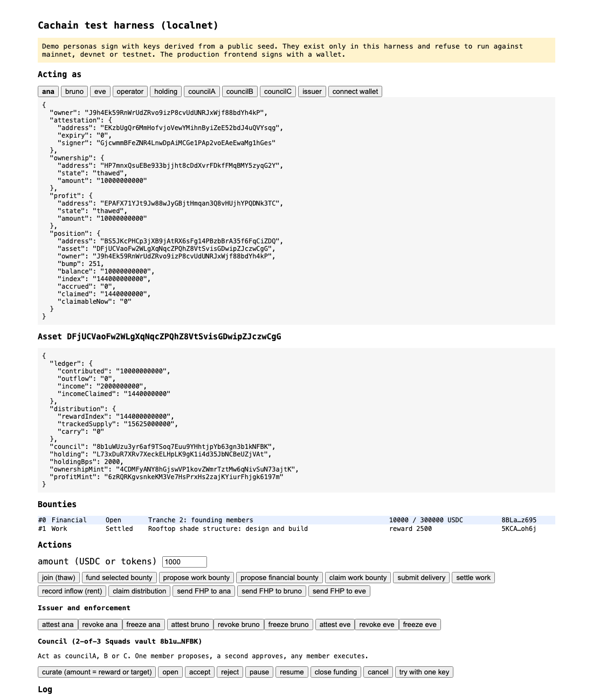

<p align="center">
  
</p>

<p align="center">
  <a href="https://github.com/melocalex/cachain/actions/workflows/ci.yml"></a>
  
  
  
  
  
</p>

<p align="center">
  <b>Cachain</b> is the on-chain protocol behind Founder Village: a curated community of founders in
  Jurerê Internacional, Florianópolis, building its own neighborhood one asset at a time and owning
  what it builds. Each asset sits in its own SPE. Members deliver work or capital through bounties,
  and receive the asset's tokens only when the delivery is real.
</p>

> [!IMPORTANT]
> **Status: a working protocol on localnet.** 49 tests pass, most of them against the real mainnet
> binaries of the Solana Attestation Service and Squads, and an independent adversarial review's
> findings are fixed. Nothing is deployed to devnet or mainnet, and the program has not had an
> external audit. This is software, not an offer: no token here is for sale, and nothing in this
> repository describes a return.

## Three promises, enforced by the program

| | What the program guarantees | How |
|---|---|---|
| **No token without delivery** | Asset tokens come into existence only from a funded financial bounty or a work bounty the council accepted. | Every mint path goes through `contribute` or `settle_work`; settling anything but an `Accepted` bounty reverts. |
| **Holding is gated, not just buying** | A wallet can hold the asset only while it has a live, unexpired attestation from the whitelist issuer. | Mints are born frozen (`DefaultAccountState = Frozen`); only `thaw_holder` thaws, and only for attested wallets. Anyone can freeze a revoked one. |
| **Nobody lists the holders** | Rent reaches every profit holder pro rata, with no snapshot, no Merkle root, and no authority stating who owns what. | An on-chain reward index plus a transfer hook that keeps every holder's balance exact. Holders pull their share. |

## Quickstart

```bash
git clone https://github.com/melocalex/cachain && cd cachain
npm install --ignore-scripts
npm run dev
```

One command builds the program if needed, fetches the SAS and Squads binaries from mainnet
(read-only), boots an **offline Surfpool**, deploys, seeds a Founder Haus scenario, prints every
address, and opens the test harness at **http://localhost:5183**.

You need Node ≥ 20.18. To rebuild the program you also need Rust ≥ 1.89, Solana CLI 4.1.2 and
Anchor 1.2.1 (`cargo install --git https://github.com/otter-sec/anchor --tag v1.2.1 anchor-cli --locked`).

<p align="center">
  
  <br><sub>The harness is deliberately plain: every action shows its instruction, accounts, signature, state before and after, and the program error when it fails.</sub>
</p>

The seeded scenario: **Ana** (verified, has funded the tranche), **Bruno** (verified), **Eve** (not
on the whitelist), the **operator** who pays rent, the **holding**, and three **council** members
behind a 2-of-3 Squads vault. Try it in this order:

1. As **eve**, press *join*: the gate refuses with `NotEligible`.
2. As **bruno**, select the rooftop work bounty, *claim* it and *submit delivery*.
3. As **councilA**, press *accept*; switch to **councilB**, *approve*, then *execute*.
4. Press *settle work*: Bruno's tokens mint, and the holding's share mints with them.
5. As **operator**, *record inflow*; as **ana**, *claim distribution*. Claim again: `NothingToClaim`.

## How it works


Founder Village's mechanism is "identify, curate, bounties, value": a member names what the
neighborhood is missing, the core contributors curate it, and it is broken into bounties that pay in
that asset's own token. Cachain makes each step an instruction with its own signer:

- A **work bounty** (design, legal, build, operate) is claimed by a member, delivered as a hash of
  the work, and accepted or rejected by the council. Settlement mints exactly the reward written at
  curation.
- A **financial bounty** is a tranche: capital is the deliverable. Each USDC contribution moves into
  the capital vault and mints the claim **in the same transaction**, at the price fixed at curation,
  until the target or the deadline.
- Every issuance mints **ownership** and **profit** tokens 1:1 to the member, and the **holding's
  share** (20%, from the config file) alongside.

## Architecture


### Account model

| Account | Seeds | Holds |
|---|---|---|
| `Asset` | `["asset", creator, asset_id]` | policy numbers from `config/founder-haus.json`, council, holding, pinned SPE treasury, SAS credential and schema, the USDC ledger, the reward index, status |
| Ownership mint | `["mint", asset, 0]` | Token-2022: `DefaultAccountState = Frozen`, `TransferHook` (no program yet), `MetadataPointer` + `TokenMetadata`; mint and freeze authority = asset |
| Profit mint | `["mint", asset, 1]` | same, with the transfer hook pointed at Cachain |
| Hook account list | `["extra-account-metas", profit_mint]` | asset, plus the sender's and receiver's positions resolved from each token account's owner |
| Capital vault | `["capital", asset]` | USDC from contributions; leaves only to the SPE treasury |
| Income vault | `["income", asset]` | USDC from rent; leaves only as holders' claims |
| `Bounty` | `["bounty", asset, id]` | kind, state, proposer, title, spec hash, terms, raised, claimant, delivery hash |
| `Position` | `["position", asset, owner]` | the owner's profit balance, last index, accrued and claimed income |
| `Receipt` | `["receipt", bounty, contributor, receipt_id]` | one contribution: amount, tokens, time |

The whitelist lives in the **Solana Attestation Service**: one attestation per wallet at
`PDA("attestation", credential, schema, wallet)`, carrying a hash of the off-chain KYC record and
a tier, never the record itself. The program re-derives that address, checks the owner, the pinned
credential and schema, the subject, the expiry, and that the signer is still authorized.

## The bounty state machine


The lifecycle lives in the program, not in a mutable config. Each transition is one instruction, an
illegal one reverts with `InvalidBountyState`, and the terms cannot change after curation.

## Distributions


A plain transfer into a vault changes no accounting: only `record_inflow` counts as rent, and it is
refused until someone holds profit tokens. Claims round down, pay once, and can never exceed what
was recorded; the part of an inflow the index cannot represent is carried, in index units, into the
next one. A test checks that once every holder has claimed, the income vault holds only rounding dust.

## Who holds which key

| Authority | Localnet demo | Intended for production |
|---|---|---|
| Council (curate, accept, pause, outflow) | Squads v4 vault, 2-of-3 demo members | Squads vault of the core contributors, with a `time_lock` as an enforced notice delay |
| Mint and freeze authority of both mints | the asset PDA | the asset PDA (the program); freeze can move to Token ACL with an upgrade |
| Attestation issuer | a demo key | a Squads vault or a dedicated, rotated issuer |
| Program upgrade authority | none (loaded by Surfpool) | a Squads multisig; immutability is a deliberate later decision |
| SPE treasury (capital destination) | a demo USDC account, pinned at creation | the SPE's account |

## Parity with the EVM prior art

An earlier version of the mechanism runs on EVM chains through Juicebox V6 and Revnet (the
[Homerun](https://github.com/mejango/homerun) repository). Reading that code taught four lessons;
each is a deliberate change here:

| Homerun (EVM) | Cachain (Solana) |
|---|---|
| Lifecycle is owner-queued configuration; the "phase" is inferred by the app | Every phase change is an instruction with its own signer and its own test |
| A closed campaign lets a client burn its claim for zero | A forbidden action reverts with a named error |
| The owner attests the holder snapshot for the initial allocation | The program tracks every profit balance; nobody attests holders |
| The allowlist gates payment beneficiaries while transfers stay open | Holding is gated: accounts are born frozen and thawed only for attested wallets |
| Two tokens: a fund claim and an income claim | Two tokens: ownership and profit |
| "Notice delay" appears in no code | Squads `time_lock` enforces one (to be set before devnet; see [DECISIONS](docs/DECISIONS.md) O8) |

## Live on devnet vs simulated locally

| | Localnet (`npm run dev`, CI) | Devnet |
|---|---|---|
| Cachain program | ✅ deployed and exercised end to end | ⏳ not deployed |
| SAS, Squads, Token-2022 | ✅ mainnet binaries | ⏳ |
| Explorer links per instruction | ✅ in the harness (custom RPC) | ⏳ |

Deploying to devnet needs a wallet you keep as upgrade authority. It is the next step, not a claim.

## Tests

```bash
npm test                 # 42 tests in LiteSVM, against the mainnet SAS and Squads binaries
npm run test:e2e         # the full path on an embedded Surfpool
cargo test -p cachain    # 6 unit and property tests of the arithmetic
```

What they prove, among others: a non-whitelisted wallet cannot be thawed or receive the token; an
account whose owner could be reassigned is refused; revocation is enforceable by anyone and keeps the
balance; no mint without an accepted bounty, and a rejected delivery mints nothing; terms cannot
change after curation; one council key cannot curate, accept, pause or move capital, and Squads
refuses to execute below the threshold; the vault always equals contributions minus recorded
outflows; the holding's share holds after mixed issuances; pause, resume, close and deadlines behave;
the hook moves future income with the token and cannot be called outside a transfer; no holder can
claim twice and payouts never exceed recorded income, even across many tiny inflows; income cannot
be recorded before anyone holds; a claimed work bounty that is never delivered can be freed; and a
holder can be revoked and frozen in one transaction. Every rejection asserts its exact error code.

Reviews so far: the Solana MCP static linter (clean), and an independent adversarial review whose
two medium findings and one low finding are fixed with regression tests. See
[docs/DECISIONS.md](docs/DECISIONS.md#reviews).

CI runs `cargo fmt`, `clippy -D warnings`, the property tests, `anchor build`, the Codama drift check,
`tsc`, `npm audit`, both test suites and the one-command bootstrap. Actions are pinned by commit SHA.

## Repository

```
programs/cachain/   Anchor program (instructions/, sas.rs, token.rs, math.rs, state.rs)
clients/ts/src/     Kit client: generated/ (Codama), protocol.ts, squads.ts, attestations.ts
app/                the test harness
scripts/            dev, localnet, seed, world, codama, dump-programs
tests/              LiteSVM suites and tests/e2e on Surfpool
config/             policy numbers for each asset
idl/                Cachain IDL and the vendored Squads v4 IDL (MIT)
docs/DECISIONS.md   every design choice, its source, and what is still open
AGENTS.md           the handoff for whoever builds the production frontend
PROMPT.md           the engineering brief this was built against
```

## What going live costs

Read live from mainnet on 2026-10-26, at 5,080 lamports per byte. Rent is a refundable bond, not a
fee; it comes back when the account closes.

| Item | Size | Rent |
|---|---|---|
| Program data (current binary) | 575,405 B | 2.92 SOL |
| `Asset` | 477 B | 0.0031 SOL |
| `Bounty` | 303 B | 0.0022 SOL |
| `Position` | 113 B | 0.0012 SOL |
| `Receipt` | 105 B | 0.0012 SOL |

A holder costs about 0.0043 SOL (two token accounts and a position). The line that dwarfs all of
these is a **security audit**, which this program needs before it holds anyone's money.

## Limits, stated plainly

Not built yet: devnet deployment, Mollusk compute benchmarks, Trident fuzzing, a verifiable build,
an asset-wide kill switch, and an external audit. Open questions for Founder Village and counsel,
including whether the income stream must be separately transferable and how work bounties are
taxed as compensation, are in [docs/DECISIONS.md](docs/DECISIONS.md).

## Disclaimer

Cachain is open-source software. It is not an offer or solicitation to buy any security or token,
and nothing here is legal, tax or financial advice. A token confers no title over a property.
Founder Village's offering documents are the only description of any offering.

## License

[Apache-2.0](LICENSE)
