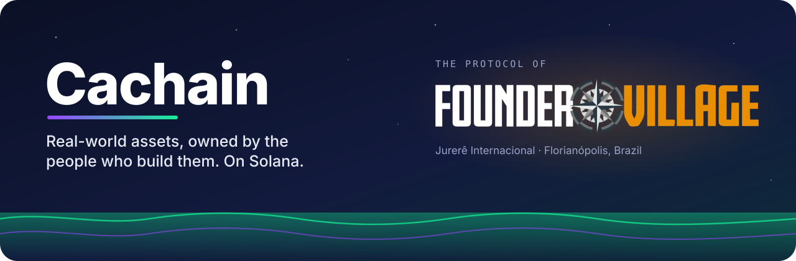
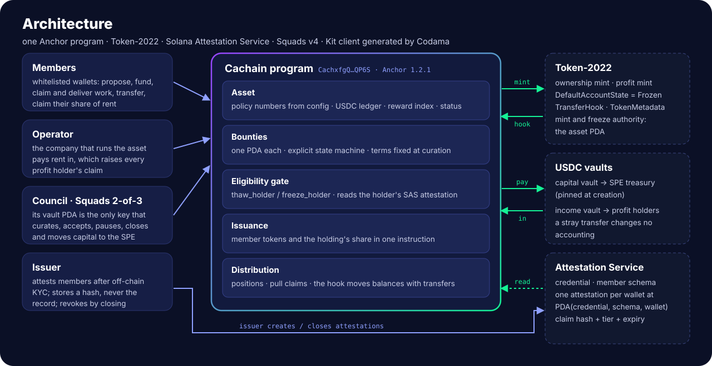
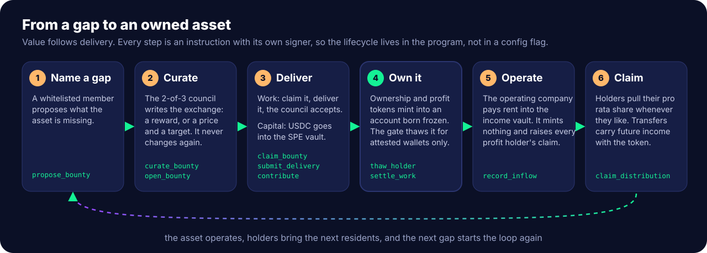
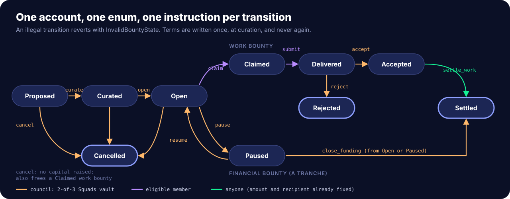
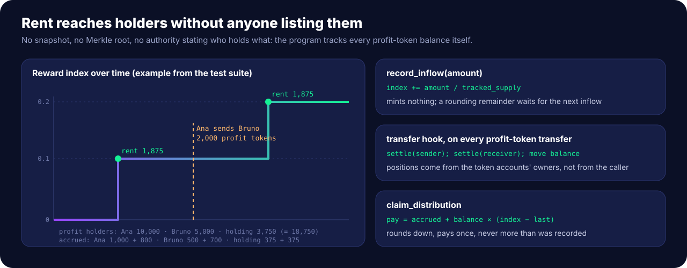

# How the Founder Village contracts work

**One page for anyone: founders, members, investors, developers.** No Solana knowledge needed.
For the code, start at the [README](../README.md); for the open questions, [DECISIONS](DECISIONS.md).

> [!NOTE]
> This describes software. It is not an offer of any token or security, and it does not describe
> any return. Founder Village's offering documents are the only description of an offering.

## 🏡 The idea in one paragraph

Founder Village builds its neighborhood one **asset** at a time (Founder Haus first). Each asset
lives in its own company (an SPV; in Brazil, an SPE). Members help build it in two ways: by doing **work** (design,
legal, build, operate) or by bringing **capital** (USDC). Both are **bounties**. When a bounty is
delivered and accepted, the member receives that asset's tokens. When the asset earns rent, the
token holders collect their share. The Founder Village program on Solana enforces those rules, so
they do not depend on anyone's goodwill or spreadsheet.

## 🧱 The pieces

| Piece | What it is, in plain words |
|---|---|
| **The Founder Village program** | The contract. One program runs every asset. Address `CachxfgQfNcVhvjGGY5KMTSijdP8SVx4MqDxDniyQP6S`. |
| **Asset** | One record per building or project: its rules (the holding's share, which whitelist, where capital may go) and its books (capital raised, rent received, rent paid out). |
| **Ownership token** | A claim on the asset itself. |
| **Profit token** | A claim on the asset's rent. Minted 1:1 with ownership, so a holder can collect income without selling ownership. |
| **Bounty** | One gap the community named: a title, what has to be delivered, and the exchange (a reward for work, or a price for capital). |
| **Council** | The core contributors, as a 2-of-3 multisig (Squads). It curates bounties, accepts deliveries and moves capital. No single person can. |
| **Whitelist** | Each member's wallet carries an attestation (Solana Attestation Service) from the issuer after off-chain checks. It holds a fingerprint (hash) of the record, never personal data. |
| **Holding** | Founder Village Holding. It receives its share (20%) of every issuance, automatically. |
| **Vaults** | Two USDC accounts per asset, controlled by the program: capital (contributions, which may only go to the SPV's account) and income (rent, which may only go to holders). |

## 🔁 The life of a bounty

1. **Name a gap.** A whitelisted member proposes it ("the rooftop needs shade").
2. **Curate.** The council accepts it and writes the exchange. From then on, the exchange can never change.
3. **Deliver.**
   - *Work:* a member claims it, delivers (the program stores a fingerprint of the delivery), and the council accepts or rejects.
   - *Capital:* members send USDC. Each contribution mints their tokens in the same step, at the curated price, until the target or deadline.
4. **Own it.** Tokens arrive only in accounts the whitelist has unlocked. The holding's share mints alongside.
5. **Operate.** The operating company pays rent into the income vault.
6. **Claim.** Each profit holder collects their share whenever they want.

Every arrow is a separate, signed action on-chain. The full map, with who signs what:

## 🛡️ What the program guarantees

- **No token without delivery.** Tokens are created only when capital arrives or the council accepts delivered work. Nothing else can mint them.
- **Holding is gated, not just buying.** Every token account starts **frozen**. The program unfreezes it only for a wallet with a valid whitelist attestation. A wallet outside the whitelist cannot receive the token at all.
- **Revocation is enforceable by anyone.** When an attestation is revoked or expires, anyone can freeze that holder's accounts. Their balance stays theirs; their income keeps counting; they can claim it after being reinstated. Nothing is confiscated.
- **No single key decides.** Curation, acceptance, pausing a raise and moving capital all need two of three council members.
- **Capital has one exit.** Raised USDC can only go to the SPV's account set at creation, and never more than was recorded.
- **Rent reaches holders without a list.** Nobody uploads a list of holders. The program counts every profit token itself, moves the count with every transfer, and lets each holder pull their share. It never pays out more than came in, and nobody can claim twice.
- **The rules are fixed in the program.** The phases of a bounty are code, not a setting someone can flip.

## 🔑 Who controls what

| Power | Held by | Notes |
|---|---|---|
| Curate, open, pause, close, accept, reject, move capital | Council (2-of-3 Squads vault) | Members can rotate inside Squads without changing the program. |
| Create and freeze/unfreeze tokens | The program itself | No person holds the mint or freeze keys. |
| Who is on the whitelist | The attestation issuer | Production: a multisig or a dedicated, rotated key. |
| Upgrade the program | The deploy wallet today; a Squads multisig before real money | Making it immutable is a deliberate later decision. |

## 📍 On-chain vs off-chain

| On-chain (public, enforced) | Off-chain (private) |
|---|---|
| bounties, terms, states, delivery fingerprints | the deliverables themselves |
| token balances, the capital and rent books | KYC records (only their fingerprint is on-chain) |
| who holds a valid attestation (as a wallet, not a name) | names, documents, the SAFT, the deal room |

## 🚦 Status today

| | |
|---|---|
| ✅ Working | Every rule above, on a local Solana network, with 49 automated tests against the real Solana Attestation Service and Squads programs, and a test app. |
| ✅ Reviewed | An independent adversarial review; its findings are fixed. |
| ✅ Live on devnet | The program and a seeded Founder Haus asset on Solana's public test network. Every address, with explorer links, is in [devnet.md](devnet.md). |
| ⏳ Before real money | An external security audit, a multisig as upgrade authority, and answers from Founder Village and counsel to the [open questions](DECISIONS.md#open). |

## ❓ Short answers

**Why two tokens?** So a member can keep their ownership and still collect rent, or pass the income right to someone else who is also whitelisted.

**Can anyone buy the token on an exchange?** No. Accounts start frozen and only whitelisted wallets are unlocked, so it cannot circulate outside the whitelist.

**What if someone is removed from the whitelist?** Their accounts can be frozen by anyone. Their tokens and accrued rent stay theirs, waiting for reinstatement.

**Who decides what counts as delivered?** The council, as two of three members. A rejected delivery mints nothing.

**Does a token give legal title to the building?** No. A token confers no title over a property.
